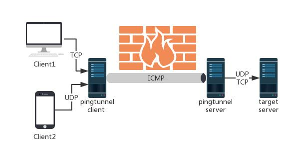

# Pingtunnel

[](https://github.com/esrrhs/pingtunnel)
[](https://github.com/esrrhs/pingtunnel)
[](https://github.com/esrrhs/pingtunnel/releases)
[](https://github.com/esrrhs/pingtunnel/releases)
[](https://hub.docker.com/repository/docker/esrrhs/pingtunnel)
[](https://github.com/esrrhs/pingtunnel/actions)
[](https://codecov.io/gh/esrrhs/pingtunnel)

Pingtunnel is a network tool that tunnels TCP/UDP/SOCKS5 traffic over ICMP Echo (Ping) packets to bypass strict network firewalls or throttled TCP/UDP traffic.

> ⚠️ **Note**: This tool is strictly intended for study and research purposes. Do not use it for any illegal purpose.



---

## 🌟 Features

- **Unified v3 security architecture**: the old numeric key and separate encryption switches are gone. A single shared password (`-password`) drives mutual authentication and end-to-end AEAD encryption (default `chacha20-poly1305`, optional `aes256`/`aes128`).
- **Multiple modes**:
  - **SOCKS5 proxy**: start a local SOCKS5 proxy with one command, with optional username/password authentication;
  - **TCP port forwarding**: reach a specific remote TCP port (e.g. SSH, web, RDP);
  - **UDP port forwarding**: forward game UDP traffic, DNS 53, etc.;
  - **Server-side secondary forwarding (`-forward`)**: the server can relay incoming traffic through an upstream SOCKS5/HTTP proxy.
- **Flexible configuration (config file mode recommended)**:
  - Run directly with a config file: `pingtunnel config.json` or `pingtunnel -c config.json`;
  - `config.json` in the current directory is loaded automatically by default;
  - Command-line flags always override the matching config file values.
- **Resilient on poor networks**: a built-in bandwidth-adaptive congestion control algorithm (`bb`) suppresses bufferbloat and packet-loss-induced stalls.

---

## 🚀 Quick Start

### Option 1: Config file mode (Recommended)

Sample files ship with the repository. Just fill in your server IP and a strong password:

#### 1. Server config (`config-server.json`)
```json
{
  "type": "server",
  "password": "YOUR_STRONG_PASSWORD_HERE",
  "encrypt": "chacha20",
  "icmp_listen": "0.0.0.0"
}
```
Start the server (requires root / administrator privileges):
```bash
sudo ./pingtunnel config-server.json
# or: sudo ./pingtunnel -c config-server.json
```

#### 2. Client config (SOCKS5 proxy mode, `config-client-socks5.json`)
```json
{
  "type": "client",
  "listen": "127.0.0.1:1080",
  "server": "YOUR_SERVER_IP",
  "socks5": true,
  "password": "YOUR_STRONG_PASSWORD_HERE",
  "encrypt": "chacha20"
}
```
Start the client:
```bash
./pingtunnel config-client-socks5.json
# or: ./pingtunnel -c config-client-socks5.json
```
Then set your browser or system proxy to SOCKS5 `127.0.0.1:1080`.

---

### Option 2: Command line (CLI)

#### 1. Start the server
Run on a machine with a public IP:
```bash
sudo ./pingtunnel -type server -password YOUR_STRONG_PASSWORD_HERE
```
*(Optional)* Disable the Linux kernel's default ICMP echo replies to avoid interference:
```bash
echo 1 > /proc/sys/net/ipv4/icmp_echo_ignore_all
```

#### 2. Start the client
- **SOCKS5 proxy mode**:
  ```bash
  ./pingtunnel -type client -l 127.0.0.1:1080 -s YOUR_SERVER_IP -socks5 -password YOUR_STRONG_PASSWORD_HERE
  ```
- **TCP port forwarding (default mode, e.g. map remote internal 192.168.1.100:22 to local port 2222)**:
  ```bash
  ./pingtunnel -type client -l :2222 -s YOUR_SERVER_IP -t 192.168.1.100:22 -password YOUR_STRONG_PASSWORD_HERE
  ```
- **UDP forwarding (e.g. local port 5353 to public DNS 8.8.8.8:53)**:
  ```bash
  ./pingtunnel -type client -l :5353 -s YOUR_SERVER_IP -t 8.8.8.8:53 -udp -password YOUR_STRONG_PASSWORD_HERE
  ```

---

## 🐳 Docker

### Run the server
```bash
docker run --name pingtunnel-server -d \
  --restart=always \
  --privileged \
  --network host \
  esrrhs/pingtunnel ./pingtunnel -type server -password YOUR_STRONG_PASSWORD_HERE
```

### Run with a mounted config file
```bash
docker run --name pingtunnel-server -d \
  --restart=always \
  --privileged \
  --network host \
  -v /etc/pingtunnel/server.json:/app/server.json:ro \
  esrrhs/pingtunnel ./pingtunnel /app/server.json
```

---


## 📖 Detailed Usage and Tuning Guide

For more advanced options and topologies (server-side secondary proxy, port forwarding, SOCKS5 authentication, flow control and congestion tuning), see:
👉 **[USAGE.md - Pingtunnel Usage and Configuration Guide](USAGE.md)**
